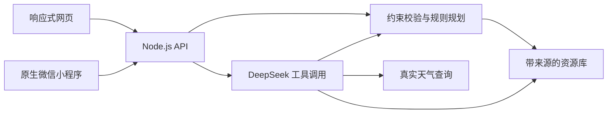

# 永嘉有礼 v2：技术与产品方案

## 产品

面向永嘉短途游客和亲子家庭，把文化资料转成可查看依据、可调整的行程草案。首先覆盖六条资源，不以资源数量替代核验质量。若未来对接真实民宿和体验点，可增加供给维护与咨询入口；本版未宣称已有合作或营收。

主要流程：发现文化主题 → 设置需求 → 同片区规划 → 查看每站安排与来源 → 改变约束 → 重算并展示变化。

## 实际技术栈

- 网页：原生 HTML / CSS / JavaScript，响应式布局，无构建依赖。
- 小程序：原生 WXML / WXSS / JavaScript，四个页面，通过 wx.request 调用后端。
- 后端：Node.js 20+ 内置 HTTP、文件和 Fetch API，无第三方运行依赖。
- AI：DeepSeek Chat Completions 工具调用，默认 `deepseek-flash`，`thinking.type=enabled`，并对 `content` 与 `reasoning_content` 做兼容处理。
- 数据：版本化结构资源库；公开来源、核验日期、项目建议和待核验事实分开保存。
- 天气：Open-Meteo 真实接口；固定县域参考点，7 日日期匹配；失败不伪造结果。
- 地图：高德官方 URI 关键词搜索入口，只用于位置查询，不用于假装计算过路径。
- 素材：原创 SVG 插画；小程序 PNG 由该矢量图实际浏览器渲染生成。

## 架构

AI 理解自然语言，工具返回可核对结果；时间预算由规则计算。没有密钥时只提供真实的规则规划，不以预写内容冒充模型调用。

## 工具定义与边界

| 工具 | 输入 | 输出 |
|---|---|---|
| find_resources | 关键词 | 匹配的文化资源与来源 |
| build_itinerary | 需求字段及修改 | 新的行程结构、时间分配、待确认事项 |
| get_weather | 出行日期 | 实时获取的县域预报或明确失败 |

最多四轮模型请求，每轮最多五个工具；API 不提供任意代码执行。模型不能直接写数据库、支付、预约或访问本地任意文件。网页把模型回复作为纯文本渲染。

## 服务 API

- GET `/api/health`：可用状态与是否配置模型，不返回密钥。
- GET `/api/resources`：文化资源库。
- POST `/api/plan`：`{profile, previous?}`，返回 `{plan, changes}`。
- GET `/api/weather?date=YYYY-MM-DD`：真实天气查询。
- POST `/api/agent`：`{message, history?, profile?}`，返回文字、执行步骤和可选新行程。

后端只接受历史消息中的 user / assistant 角色，不接受客户端提供系统指令。请求体有长度限制，模型请求有超时、并发和调用次数保护。当前次数限制保存在内存，重启会清零；正式部署需要持久化配额与进一步鉴权。

## 真实能力与后续工作

本版尚不具备真实车程优化、当天开放核验、课程库存、预约支付或真实商户运营数据。规则测试证明时间分配不超设定预算，不证明现实路程一定可行。正式比赛前仍需真实模型和微信端验收。

## 官方技术依据

2026-09-24 核对：[DeepSeek Chat Completions](https://api-docs.deepseek.com/api/create-chat-completion/)、[DeepSeek 思考模式](https://api-docs.deepseek.com/guides/thinking_mode/)、[Open-Meteo 文档](https://open-meteo.com/en/docs)、[高德 URI 搜索](https://developer.amap.com/api/uri-api/guide/search/search)。实际模型可用性最终以账户 API 返回为准。
